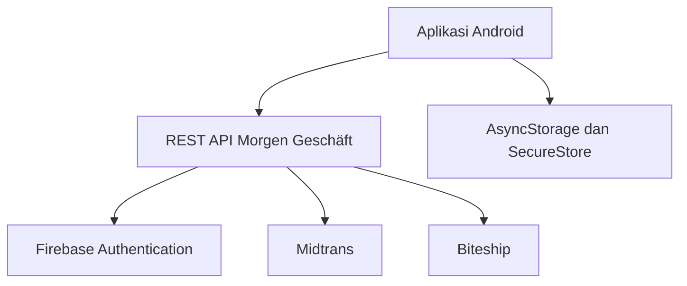

<div align="center">
  

# Morgen Geschäft Mobile

**Aplikasi pelanggan Android untuk belanja, pembayaran, pengiriman, loyalty, referral, konten, dan layanan setelah pembelian dalam satu pengalaman native.**

[Website](https://morgengeschaft.com/id) · [English](https://morgengeschaft.com/en) · [Dokumentasi lengkap](./docs/README.md) · [Changelog](./CHANGELOG.md) · [MIT License](./LICENSE)


</div>

---

## Tentang project

Morgen Geschäft Mobile adalah aplikasi pelanggan berbasis **React Native + Expo** untuk ekosistem e-commerce Morgen Geschäft. Aplikasi mengambil produk, promo, artikel, ulasan, akun, transaksi, dan status pengiriman dari backend yang sama dengan website.

Pelanggan dapat berbelanja sebagai tamu atau menggunakan akun OTP, menyelesaikan pembayaran melalui Midtrans, memilih pengiriman yang diproses melalui Biteship, melacak pesanan, memakai reward, serta mengakses layanan setelah pembelian langsung dari Android.

> Repository ini berisi source aplikasi mobile. Website, panel administrasi, database remote, credential layanan, dan penerima webhook dikelola pada backend Morgen Geschäft.

## Fitur utama

### Belanja

- Beranda native dengan promo, produk populer, ulasan, artikel, dan pintasan fitur.
- Katalog dengan pencarian, kategori, stok aktif, dan tampilan bilingual.
- Detail produk, harga, kandungan, atribut produk, serta rekomendasi terkait.
- Wishlist dan keranjang yang tersimpan pada perangkat.
- Pendaftaran notifikasi ketika produk kembali tersedia.

### Checkout dan reward

- Checkout sebagai tamu atau pelanggan terdaftar.
- Pencarian area, pilihan kurir, estimasi, dan ongkir melalui backend Biteship.
- Kupon, loyalty points, dan saldo referral.
- Perhitungan transaksi dan validasi stok dari server.
- Pembayaran Midtrans melalui browser aman.
- Idempotency key untuk mencegah transaksi ganda akibat pengiriman ulang request.

### Akun dan pesanan

- Daftar dan login tanpa password menggunakan OTP email.
- Sesi Firebase yang disimpan dengan Expo SecureStore.
- Profil pelanggan, alamat, poin, saldo referral, dan riwayat reward.
- Riwayat pesanan akun serta pesanan tamu dari perangkat yang sama.
- Detail pesanan, timeline status, resi, perjalanan paket, dan live tracking.
- Lanjutkan pembayaran atau batalkan pesanan pending sesuai token akses.
- Pengajuan retur dengan jenis masalah, solusi, deskripsi, dan bukti foto.

### Konten dan bantuan

- Ulasan pelanggan dengan foto dan tombol membantu.
- Inbox notifikasi untuk akun, pesanan tamu, dan informasi publik.
- Baseline notifikasi agar perangkat baru tidak menampilkan pesan lama sebagai pesan baru.
- Artikel, promo, FAQ, kebijakan privasi, dan syarat ketentuan.
- Kuis tipe kulit non-diagnostik.
- GESA sebagai asisten informasi pelanggan.
- Kanal bantuan melalui WhatsApp dan tautan resmi Morgen Geschäft.
- Antarmuka Bahasa Indonesia dan English.

## Teknologi

| Bagian            | Teknologi                                                   |
| ----------------- | ----------------------------------------------------------- |
| Mobile            | React Native 0.86, React 19                                 |
| Framework         | Expo SDK 57                                                 |
| Routing           | Expo Router dengan typed routes                             |
| Language          | TypeScript 6 strict                                         |
| State             | React Context                                               |
| Penyimpanan lokal | AsyncStorage dan Expo SecureStore                           |
| Media             | Expo Image dan Expo Image Picker                            |
| Autentikasi       | Firebase custom token dan Identity Toolkit                  |
| Pembayaran        | Midtrans melalui backend dan secure browser                 |
| Pengiriman        | Biteship melalui backend                                    |
| Build Android     | EAS Build                                                   |
| Quality gate      | ESLint, Prettier, TypeScript, Node Test Runner, Expo Doctor |
| CI                | GitHub Actions dan Dependabot                               |

## Arsitektur



Aplikasi tidak menyimpan server key atau credential provider. Backend menangani validasi harga, stok, kupon, reward, hak akses pesanan, transaksi, pembayaran, tarif pengiriman, webhook, dan perubahan status.

## Struktur repository

```text
.
├── .github/                 # CI, Dependabot, dan template kontribusi
├── assets/
│   └── images/              # Logo, ikon aplikasi, maskot, dan ikon tab
├── docs/
│   └── README.md            # Dokumentasi teknis dan penggunaan lengkap
├── scripts/                 # Pemeriksaan link dan repository publik
├── src/
│   ├── app/                 # Route dan layar Expo Router
│   ├── components/          # Komponen UI bersama
│   ├── constants/           # Konstanta brand dan konten statis
│   ├── context/             # State toko, akun, keranjang, dan wishlist
│   ├── lib/                 # API, autentikasi, notifikasi, dan storage
│   └── types/               # Model data TypeScript
├── tests/                   # Unit test
├── app.json                 # Identitas dan konfigurasi Expo
├── eas.json                 # Profil development dan APK
├── package.json             # Dependensi dan perintah project
└── README.md                # Halaman depan repository
```

## Persyaratan

- Node.js `22.13.x` sesuai `.nvmrc`.
- npm 10 atau lebih baru.
- Android Studio dengan emulator atau perangkat Android.
- Backend Morgen Geschäft yang dapat diakses melalui HTTPS.
- Firebase Web API key untuk autentikasi pelanggan.

## Menjalankan secara lokal

Instal dependency dan buat environment lokal:

```bash
npm ci
cp .env.example .env
```

Pada Windows PowerShell:

```powershell
Copy-Item .env.example .env
```

Jalankan development server:

```bash
npm run start
```

Nyalakan emulator Android, lalu tekan `a` pada terminal Expo. Untuk pengujian modul native yang paling akurat, gunakan development build.

## Environment

| Variable                       | Fungsi                                        |
| ------------------------------ | --------------------------------------------- |
| `EXPO_PUBLIC_API_BASE`         | URL dasar backend HTTPS tanpa `/` di akhir    |
| `EXPO_PUBLIC_STORE_WHATSAPP`   | Nomor bantuan dalam format internasional      |
| `EXPO_PUBLIC_FIREBASE_API_KEY` | Firebase Web API key untuk autentikasi client |

Salin nama variable dari [`.env.example`](./.env.example). Jangan menyimpan server key, service account, password, private key, token backend, atau webhook secret dalam variable `EXPO_PUBLIC_*` karena nilainya menjadi bagian dari bundle aplikasi.

## Quality gate

Jalankan seluruh pemeriksaan repository:

```bash
npm run validate
```

Perintah tersebut menjalankan:

```bash
npm run format:check
npm run lint
npm run typecheck
npm test
npm run check:links
npm run check:sensitive
npm run build
```

Periksa juga konsistensi project Expo setelah perubahan dependency atau konfigurasi native:

```bash
npm run doctor
```

## Build Android

Development build:

```bash
npx eas-cli@latest build --platform android --profile development
```

APK pengujian internal:

```bash
npx eas-cli@latest build --platform android --profile preview
```

APK distribusi langsung:

```bash
npx eas-cli@latest build --platform android --profile production-apk
```

Build untuk store:

```bash
npx eas-cli@latest build --platform android --profile production-store
```

Naikkan `expo.version` dan `android.versionCode` pada `app.json` untuk setiap rilis baru. Gunakan keystore Android yang sama agar pembaruan dapat dipasang di atas versi sebelumnya.

## Isi repository publik

Repository mencakup source aplikasi, aset yang dibundel, dokumentasi, test, script pemeriksaan, konfigurasi Expo/EAS, serta otomasi GitHub.

File environment lokal, credential, `node_modules`, `.expo`, `dist`, log, backup, upload pelanggan, source map, ZIP, APK, dan AAB dikecualikan melalui `.gitignore`. Hanya `.env.example` tanpa nilai rahasia yang disertakan sebagai acuan konfigurasi.

## Dokumentasi

Dokumentasi lengkap tersedia pada **[docs/README.md](./docs/README.md)** dan mencakup:

- panduan penggunaan seluruh fitur;
- arsitektur aplikasi, backend, dan penyimpanan;
- autentikasi, model data, API, dan webhook;
- keamanan, testing, build, monitoring, dan backup;
- troubleshooting dan panduan kontribusi.

## Keamanan

Jangan mengirim laporan kerentanan melalui issue publik. Gunakan proses pelaporan privat pada [SECURITY.md](./SECURITY.md).

## Kontribusi

1. Fork repository dan buat branch yang fokus pada satu perubahan.
2. Pertahankan TypeScript strict dan gunakan komponen bersama.
3. Tambahkan atau perbarui test untuk logika yang berubah.
4. Jalankan `npm run validate`.
5. Jangan mengirim credential, data pelanggan, atau artifact build.
6. Jelaskan dampak, cara pengujian, dan tangkapan layar untuk perubahan UI.

Setiap contributor mengikuti [Code of Conduct](./CODE_OF_CONDUCT.md). Perubahan penting dicatat pada [CHANGELOG.md](./CHANGELOG.md).

## Lisensi

Project dirilis menggunakan **MIT License**. Source dapat digunakan, dipelajari, dimodifikasi, dan didistribusikan dengan tetap menyertakan pemberitahuan hak cipta serta lisensi.

Lihat [LICENSE](./LICENSE) untuk teks lengkap.

---

<div align="center">
  <sub>Morgen Geschäft Mobile · Satu ekosistem belanja, langsung dari Android.</sub>
</div>
